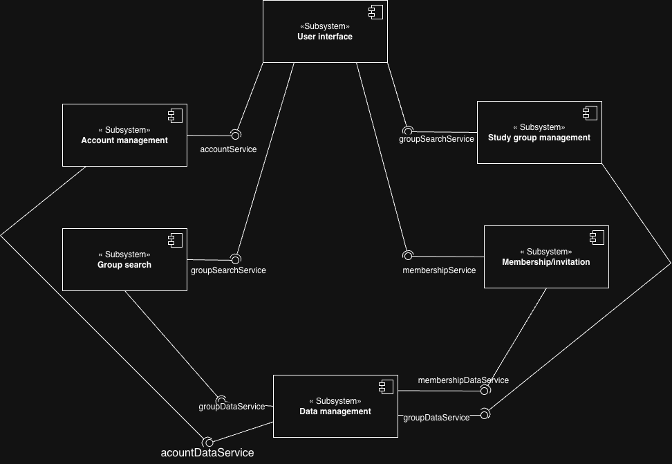
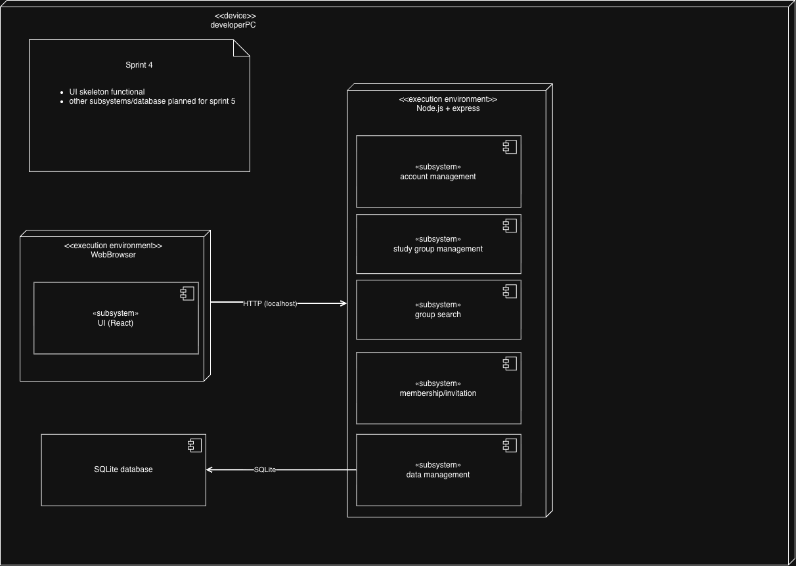

# CampuStudy

## Collaborators Involved in the Project
1. Abel Sebhatu
2. Joseph Maslanka
3. Hannah Kuklinski
4. Jon Chernus
5. Tim Burda
6. Muhammad Sayyad

## Purpose
CampuStudy helps students connect with study groups based on subject, schedule, and study preferences.

## Technology Stack

CampuStudy uses a three-tier client-server architecture consisting of a React frontend, a Node.js/Express backend, and a SQLite database.

| Layer | Technology | Justification |
|---|---|---|
| Language(s) | Javascript | Allows the team to use one language across frontend and backend, reducing development complexity. |
| Frontend | React | Supports reusable interface components for study group searching, account pages, and forms, supporting our usability goal (NFR1). |
| Backend | Node.js + Express | Provides a separate backend for handling application logic, authentication, and group management. Centralizing authorization checks supports our security design goal (NFR4) by preventing unauthorized changes to study groups. |
| Database | SQLite | SQLite provides lightweight relational storage for users, study groups, invitations, and memberships. Its simple local setup makes it practical for our initial deployment, while supporting the group search and data management subsystems defined in Sprint 3. |
| APIs / External Services (optional) | University authentication (planned) | Supports the Sprint 1 institutional authentication constraint (C2), subject to available university integration access. |
| Deployment / Hosting (optional) | Local development computers | Allows the team to run and test the basic system without setting up paid hosting. |

## Uncertainties
+ University authentication is an uncertainty. We discussed in our group and thought it would be a good idea to introduce. However, we are unsure how feasible it will be to implement.

## Architecture

### Subsystem Decomposition



### Deployment Diagram



### Project Structure

CampuStudy follows the three-tier client-server architecture established in Sprint 3.

| Subsystem (Sprint 3) | Folder | Status |
|---|---|---|
| User interface | `frontend/` | Running skeleton |
| Account management | `backend/src/subsystems/account-management/` | Placeholder files |
| Study group management | `backend/src/subsystems/study-group-management/` | Placeholder files |
| Group search | `backend/src/subsystems/group-search/` | Placeholder files |
| Membership/invitation | `backend/src/subsystems/membership-invitation/` | Placeholder files |
| Data management | `backend/src/subsystems/data-management/` | Placeholder file |

Other folders and files:

- `backend/src/middleware/` — Planned authentication and error-handling middleware.
- `backend/src/tests/` — Placeholder for backend tests.
- `docs/` — Sprint 3 subsystem decomposition and Sprint 4 deployment diagrams.
- `user-stories.md` — User stories and acceptance criteria.
- `product-backlog.md` — Prioritized product backlog and MVP planning.

## How to Run the Skeleton

Only the frontend can be run at this point. The backend currently only installs the SQLite package; there is no server to start yet.

## Prerequisites

To run the frontend locally, you need:

- Git
- Node.js 20.19+ or 22.12+ (required by Vite) — tested with v24.21.0
- npm (included with Node.js) — tested with 11.19.0
- A modern web browser

## How to run frontend
```
# In repo root
cd frontend
npm install
npm run dev
```
## How to install database
```
# In repo root
cd backend
npm install
(+ another step in the future when I get to creating the schema)
```

## How to Verify the Application

After running `npm run dev` inside the `frontend/` folder, the terminal should display a local development URL, typically:

`http://localhost:5173/`

Opening that address in a browser should display:

**Welcome to CampuStudy**

*Find and connect with study groups at Pitt.*

This confirms the frontend skeleton is working locally.

## Current Implementation Status

### Working

- React application initialized using Vite.
- Basic CampuStudy homepage implemented.
- Frontend runs locally in a browser.
- Folder structure that follows the Sprint 3 subsystem decomposition, with placeholder files for each backend subsystem.
- Subsystem decomposition and deployment diagrams added.
- SQLite package (better-sqlite3) and database connection set up in the backend.

### Not Yet Implemented

- Backend API functionality
- SQLite database integration
- University authentication
- Account management
- Study group creation and editing
- Group searching and filtering
- Invitation and membership management

The remaining features will be developed during future sprints.
